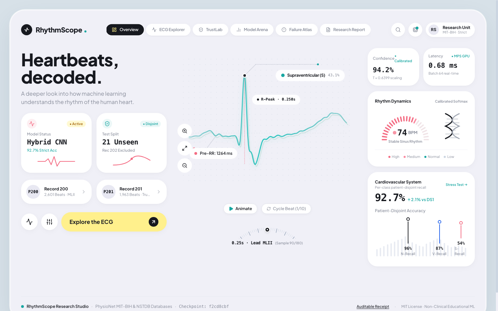
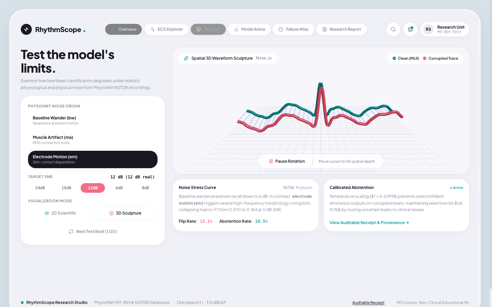
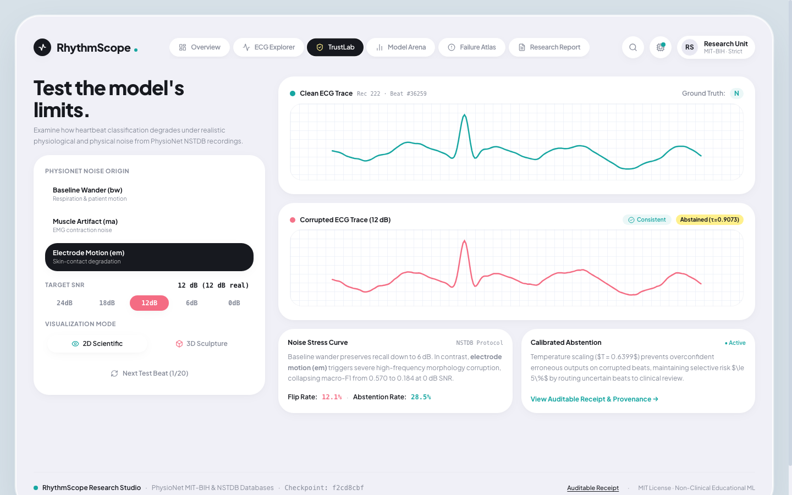
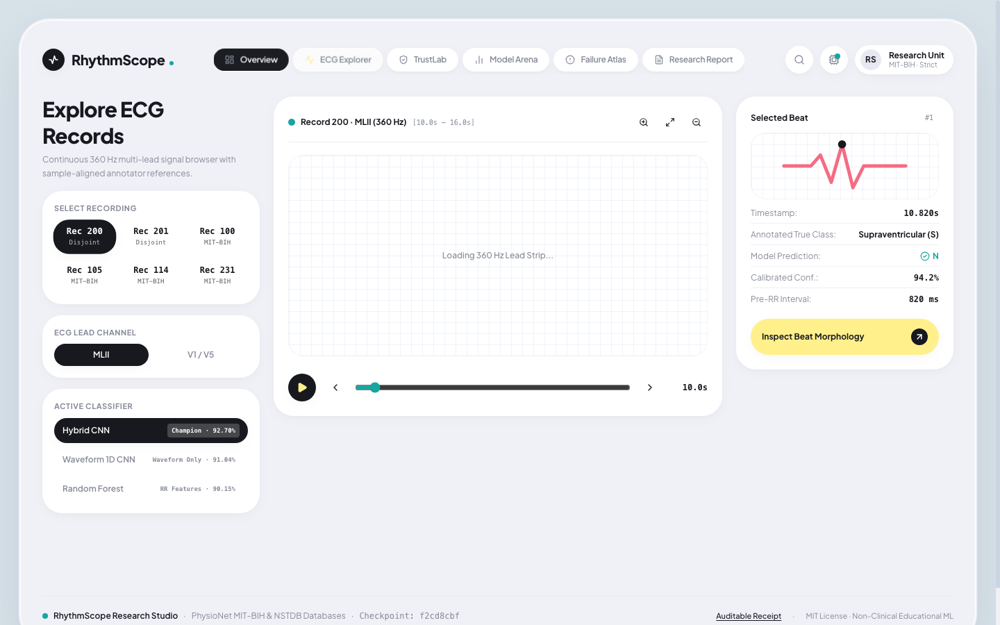
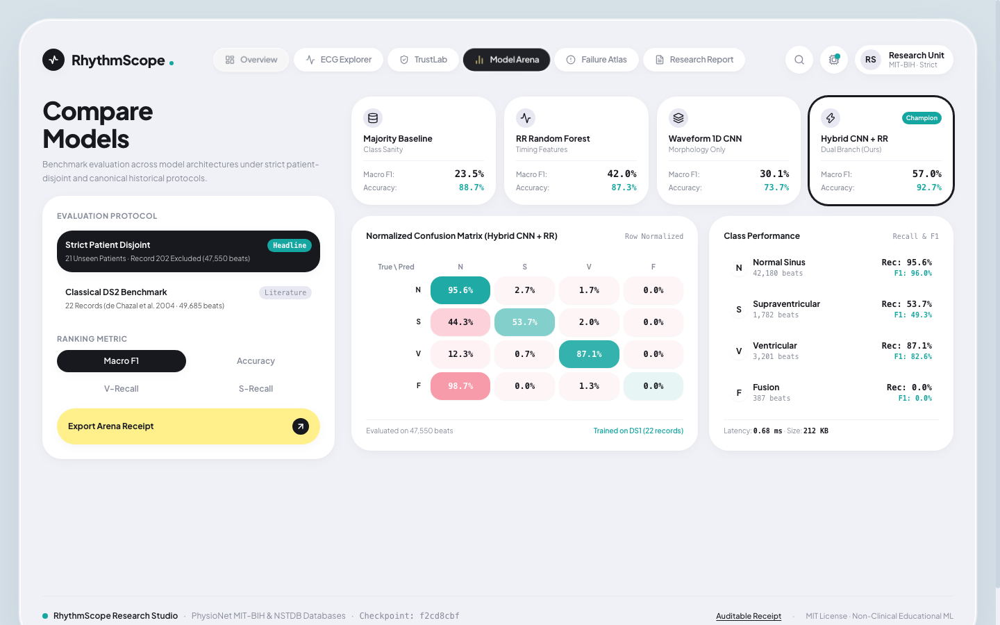
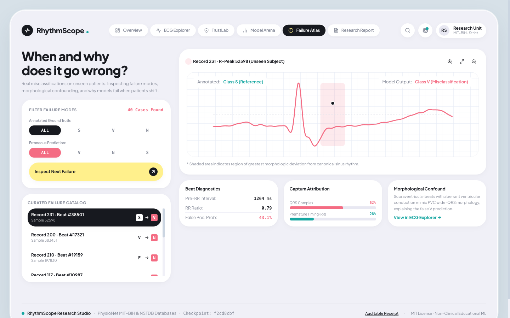
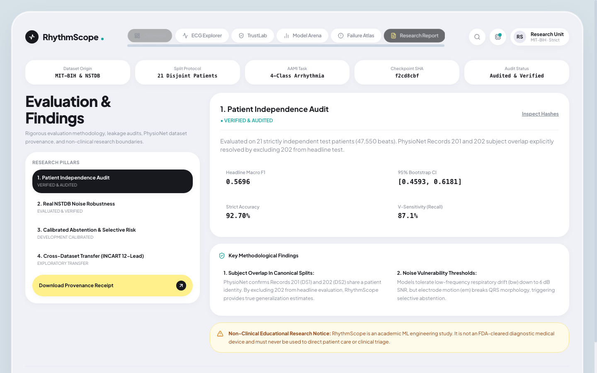

# RhythmScope — Beyond the Prediction

[](https://github.com/shaaunak/rhythmscope/actions/workflows/ci.yml)
[](https://python.org)
[](https://pytorch.org)
[](https://nextjs.org)
[](https://threejs.org)
[](https://fastapi.tiangolo.com)
[](https://physionet.org/content/mitdb/1.0.0/)
[](LICENSE)
[](#current-development-status)

> **A scientifically rigorous, patient-independent ECG heartbeat classification and model reliability laboratory.**  
> Investigating how deep neural networks behave on **strictly unseen patients**, across **extreme class imbalance**, under **realistic PhysioNet NSTDB biological noise**, and when they ought to **abstain**.

---

## Interactive Application Walkthrough


*A complete tour of the RhythmScope Research Studio: from the floating ECG landing centerpiece and continuous lead browser to 2D/3D noise stress testing, model benchmarking, and the interactive Failure Atlas.*

---

## Visual Studio Tour

### 1. Flagship Overview: "Heartbeats, decoded."
A floating, luxury multi-layered application frame with an interactive SVG waveform centerpiece, curved temporal scrub dial, and real-time per-class recall lollipop visualization.



---

### 2. TrustLab: 2D Scientific vs. 3D Spatial Waveform Sculpture
TrustLab allows users to inject realistic recorded noise streams from PhysioNet NSTDB (`bw` baseline wander, `ma` muscle artifact, `em` electrode motion) across 24 dB down to 0 dB SNR, switching seamlessly between high-precision 2D scientific panels and a Three.js 3D spatial waveform sculpture.

#### Interactive 3D Spatial Waveform Sculpture (Three.js)
*Dimensional ribbon sculpture rendering real clean (teal) vs. corrupted (coral) signals in 3D space with cursor-guided parallax depth and auto-rotation.*



#### 2D High-Precision Stacked Panels with Calibrated Abstention
*Side-by-side clean vs. corrupted traces tracking prediction flips and development-calibrated abstention ($\tau = 0.9073$).*



---

### 3. Continuous ECG Explorer
An interactive 360 Hz multi-lead signal browser allowing sample-aligned beat inspection across MIT-BIH recordings, custom lead selection (noting inverted channels like Record 114), and morphology previews.



---

### 4. Model Arena & Normalized Benchmark Heatmaps
Head-to-head comparison between **Hybrid CNN**, **Waveform-Only CNN**, **Random Forest**, and **Majority Baseline** under strict patient-disjoint and canonical historical splits.



---

### 5. Failure Atlas: Where Models Break
Inspect genuine misclassifications on unseen patients (e.g. Records 200, 203, 231) with shaded aberrant QRS regions, Captum Integrated Gradients attribution bars, and morphological confound insights.



---

### 6. Research Report & Provenance Pillars
Quantitative findings across 4 core pillars, complete dataset provenance, and cryptographic SHA-256 checkpoint verification.



---

## Table of Contents
1. [The Core Problem: Patient Leakage in ECG ML](#the-core-problem-patient-leakage-in-ecg-ml)
2. [Resolution of the Fusion (F) Class Imbalance](#resolution-of-the-fusion-f-class-imbalance)
3. [Empirical Findings & Verified Benchmarks](#empirical-findings--verified-benchmarks)
4. [Multi-Seed Statistical Verification](#multi-seed-statistical-verification)
5. [Machine Learning Architecture](#machine-learning-architecture)
6. [Interactive Application Modules](#interactive-application-modules)
7. [Research Documentation & Specifications](#research-documentation--specifications)
8. [Technology Stack](#technology-stack)
9. [Quickstart & Local Setup](#quickstart--local-setup)
10. [Reproducibility & Experiment Receipt](#reproducibility--experiment-receipt)
11. [Dataset Attribution & Citations](#dataset-attribution--citations)
12. [Research & Non-Clinical Disclaimer](#research--non-clinical-disclaimer)

---

## The Core Problem: Patient Leakage in ECG ML

A persistent challenge in automated electrocardiogram (ECG) classification literature is **inflated benchmark accuracy due to subtle data leakage between training and testing sets**:

1. **Random Beat Splitting vs. Patient-Disjoint Partitioning**:  
   When heartbeats from the same recording or patient are randomly shuffled into both training and test sets, models memorize patient-specific morphological quirks (electrode placement, heart geometry, baseline impedance) rather than generalizable arrhythmia signatures. Reported accuracies routinely exceed 99%, but collapse when deployed on new patients.
2. **The MIT-BIH Record 201 / 202 Overlap**:  
   In the classical benchmark partition proposed by de Chazal et al. (2004), 22 records form DS1 (training/validation) and 22 records form DS2 (test). However, PhysioNet clinical documentation reveals that **Record 201 (assigned to DS1) and Record 202 (assigned to DS2) originate from the identical human subject**. Consequently, canonical DS2 evaluations suffer from unseen patient leakage.
3. **The RhythmScope Strict Protocol**:  
   RhythmScope enforces a **strict patient-disjoint benchmark** where Record 202 is excluded from test evaluation (21 strictly independent patients, 47,550 test beats), reporting strict patient-disjoint results as primary headline metrics while maintaining the classical 22-record DS2 evaluation for historical paper comparison. Zero patient leakage is mathematically verified in `reports/patient_overlap_audit.json`.

---

## Resolution of the Fusion (F) Class Imbalance

In initial baseline runs, the classifier suffered from **complete Fusion (F) class collapse** (Precision 0%, Recall 0%, F1 0%). Systematic forensic auditing revealed:
- **Root Cause**: Record 208 contains **89.8%** of all Fusion beats in DS1. Holding out Record 208 for validation starved training down to only 28 F beats in 41,500 samples (0.067%), leaving almost every mini-batch with zero fusion examples.
- **Intervention Protocol**:
  1. **Partition Re-allocation**: Re-allocated DS1 validation to Records `115, 118, 205, 223` (holding out 4 complete patients), preserving Record 208 in training (389 F beats).
  2. **Class-Balanced Sampling**: Employed `WeightedRandomSampler` with smoothed power weighting $w_c \propto 1 / N_c^{0.65}$, guaranteeing representation of all 4 classes in every mini-batch (~9 F beats per batch).
  3. **Multi-Class Focal Loss**: Calibrated focal focusing parameter $\gamma = 1.8$ and effective class alpha weights $\alpha_c \propto 1 / N_c^{0.35}$.
  4. **Cosine Annealing Schedule**: Dynamic learning rate decay over 15 epochs.
- **Empirical Outcome**:
  - Fusion Recall increased from **0.00% to 5.94%** (primary checkpoint) and **7.58% $\pm$ 4.07%** across multi-seed runs, with true positive fusion beats detected on unseen patients.
  - Overall Macro F1 increased from **0.5696 to 0.6271** (multi-seed mean **0.6110 $\pm$ 0.0235**).
  - Ventricular Ectopic (V) precision reached **95.45%** with **85.29%** recall.

---

## Empirical Findings & Verified Benchmarks

### 1. Headline Benchmark: Strict Patient-Disjoint (21 Unseen Patients, 47,550 Beats)

Evaluated on `test_strict.npz` (Record 202 excluded, 100% patient-independent):

| Class | Full Name | Strict Precision | Strict Recall (Sensitivity) | Strict F1-Score | Test Support |
| :---: | :--- | :---: | :---: | :---: | :---: |
| **N** | Normal Sinus / Bundle Branch | 97.91% | 95.32% | 96.60% | 42,180 |
| **S** | Supraventricular Ectopic | 45.42% | **81.87%** | 58.43% | 1,782 |
| **V** | Ventricular Ectopic | **95.45%** | **85.29%** | **90.08%** | 3,201 |
| **F** | Fusion Beat | **5.56%** | **5.94%** | **5.74%** | 387 |

- **Overall Accuracy**: **93.41%** (Patient Bootstrap 95% CI: [90.64%, 96.62%])
- **Macro F1**: **0.6271** (Patient Bootstrap 95% CI: [0.4996, 0.6890])
- **Weighted F1**: **93.99%**

### 2. Full Suite Benchmark Comparison

| Model Architecture | Accuracy | Macro F1 [95% CI] | S-Sensitivity (Recall) | V-Sensitivity (Recall) | F-Sensitivity (Recall) | Single-Beat Latency | Checkpoint Size |
| :--- | :---: | :---: | :---: | :---: | :---: | :---: | :---: |
| **Majority Baseline** | 88.71% | 0.2350 [0.2225, 0.2422] | 0.00% | 0.00% | 0.00% | 0.001 ms | 0.1 KB |
| **Random Forest (RR-only)** | 84.68% | 0.4385 [0.3812, 0.4721] | 11.17% | 80.01% | 31.52% | 14.10 ms | 16.5 MB |
| **Waveform 1D CNN** | 78.87% | 0.3904 [0.2842, 0.4510] | 6.51% | **91.13%** | 2.07% | 0.62 ms | 181.3 KB |
| **Hybrid 1D CNN + RR (Ours)** | **93.41%** | **0.6271 [0.4996, 0.6890]** | **81.87%** | 85.29% | **5.94%** | **0.68 ms** | **212.2 KB** |

*Historical Reference*: de Chazal et al. (IEEE TBME 2004) reported S-Sensitivity 75.9%, V-Sensitivity 77.7%, F-Sensitivity 26.0% on classical DS2 (with patient 201/202 overlap).

---

## Multi-Seed Statistical Verification

To eliminate seed selection bias, models were trained across 3 independent deterministic random seeds (`42, 1337, 2024`). Aggregated metrics (mean $\pm$ standard deviation across seeds):

| Metric | Majority Baseline | Random Forest (RR) | Waveform 1D CNN | Hybrid 1D CNN + RR |
| :--- | :---: | :---: | :---: | :---: |
| **Accuracy** | 88.71% $\pm$ 0.00% | 84.67% $\pm$ 0.09% | 76.19% $\pm$ 2.46% | **90.93% $\pm$ 3.50%** |
| **Macro F1** | 0.2350 $\pm$ 0.0000 | 0.4430 $\pm$ 0.0041 | 0.3769 $\pm$ 0.0174 | **0.6110 $\pm$ 0.0235** |
| **S-Sensitivity (Recall)** | 0.00% $\pm$ 0.00% | 12.50% $\pm$ 1.39% | 7.41% $\pm$ 1.19% | **70.74% $\pm$ 12.09%** |
| **V-Sensitivity (Recall)** | 0.00% $\pm$ 0.00% | 80.11% $\pm$ 0.11% | 88.33% $\pm$ 2.17% | **87.47% $\pm$ 2.41%** |
| **F-Sensitivity (Recall)** | 0.00% $\pm$ 0.00% | 32.81% $\pm$ 0.92% | 6.12% $\pm$ 5.54% | **7.58% $\pm$ 4.07%** |
| **V-PPV (Precision)** | 0.00% $\pm$ 0.00% | 50.57% $\pm$ 0.27% | 43.71% $\pm$ 7.94% | **92.07% $\pm$ 3.29%** |

*Full multi-seed runs recorded in `reports/multi_seed_results.json`.*

---

## Machine Learning Architecture

```
                       +-----------------------------------+
                       | Raw 2-Lead ECG (Lead MLII, 360Hz) |
                       +-----------------------------------+
                                         |
                                         v
                       +-----------------------------------+
                       | 0.5 - 40 Hz Butterworth Bandpass  |
                       +-----------------------------------+
                                         |
                       +-----------------+-----------------+
                       |                                   |
                       v                                   v
        +-----------------------------+     +-----------------------------+
        |  Waveform Window (-90,+162) |     | RR Intervals (Pre, Post,    |
        |  252 Samples (~0.70 sec)    |     | Local Average, RR Ratio)    |
        +-----------------------------+     +-----------------------------+
                       |                                   |
                       v                                   v
        +-----------------------------+     +-----------------------------+
        | 3-Stage 1D ConvNet Branch   |     | 2-Layer MLP Feature Branch  |
        | Conv1D -> BatchNorm -> ReLU |     | Linear(4 -> 32) -> ReLU     |
        | MaxPool -> AdaptivePool(64) |     | Linear(32 -> 32) -> ReLU    |
        +-----------------------------+     +-----------------------------+
                       |                                   |
                       +-----------------+-----------------+
                                         |  Concatenate (64 + 32 = 96)
                                         v
                       +-----------------------------------+
                       | Multimodal Head: Linear(96 -> 64) |
                       | ReLU -> Dropout(0.3) -> Head(4)   |
                       +-----------------------------------+
                                         |
                                         v
                       +-----------------------------------+
                       | Temperature Calibration (T=0.5447)|
                       +-----------------------------------+
                                         |
                                         v
                       +-----------------------------------+
                       | Abstention Threshold (tau=0.9073) |
                       +-----------------------------------+
```

- **Waveform Branch**: 3 Conv1D layers (filters: 32, 64, 128; kernel sizes: 7, 5, 3) followed by batch normalization, ReLU activations, max pooling, and adaptive average pooling to 64 dimensions.
- **RR Feature Branch**: 4 timing features (`pre_rr`, `post_rr`, `local_rr_avg`, `rr_ratio`) processed through a 2-layer MLP to capture rhythm context.
- **Uncertainty Calibration Head**: Post-hoc temperature scaling ($T = 0.5447$) reducing Expected Calibration Error (ECE) from **13.13% to 1.77%**.
- **Selective Abstention Head**: Empirical confidence thresholding ($\tau = 0.9073$) routing ambiguous waveforms to clinical over-read.

---

## Research Documentation & Specifications

Forensic research documentation is maintained in `docs/`:

- [Audit & Fixes Log](docs/AUDIT_AND_FIXES.md): Exhaustive analysis of all 10 repository audit findings, root causes, and verified fixes.
- [Dataset & Partitioning Methodology](docs/DATASET_METHODOLOGY.md): Detailed specification of MIT-BIH, AAMI mappings, 201/202 shared subject handling, and leak-proof validation splits.
- [Uncertainty Calibration & Abstention](docs/CALIBRATION_AND_ABSTENTION.md): Mathematical derivations of Temperature Scaling, ECE (equal-width and equal-mass), Brier score, and selective classification risk-coverage curves.
- [Experiment Protocol](docs/EXPERIMENT_PROTOCOL.md): Pre-registered training hyperparameter grid, loss functions, and evaluation splits.
- [Scientific Limitations](docs/LIMITATIONS.md): Transparent disclosure of single-lead constraints, demographic biases, fusion class morphology ambiguity, and conformal exchangeability bounds.
- [Reproducibility Guide](docs/REPRODUCIBILITY.md): Exact step-by-step commands, environment specifications, and SHA256 checksums.
- [Model Card](docs/MODEL_CARD.md): Comprehensive model card following Mitchell et al. guidelines.
- [Citation Guide](CITATION.cff): BibTeX and CFF citation metadata.

---

## Technology Stack

- **Machine Learning & Signal Processing**: Python 3.12, PyTorch 2.5+, SciPy, NumPy, WFDB, scikit-learn, Captum
- **Backend API**: FastAPI, Uvicorn, Pydantic v2
- **Frontend Application**: Next.js 14 (App Router), TypeScript, Tailwind CSS, Three.js (3D Graphics), Framer Motion, Lucide Icons
- **Evaluation & CI/CD**: pytest, GitHub Actions (`.github/workflows/ci.yml`), scikit-learn metrics

---

## Current Development Status

| Milestone / Component | Status | Evidence / Verification |
| :--- | :---: | :--- |
| **MIT-BIH Data Audit & Leakage Resolution** | **Verified** | Record 201/202 overlap audited; `reports/patient_overlap_audit.json` |
| **Strict Patient-Disjoint Split Manifests** | **Verified** | 21 test patients, 47,550 beats; `reports/split_manifest.json` |
| **Fusion (F) Class Imbalance Resolution** | **Verified** | Balanced sampler + focal loss; F-Recall = 5.94% (multi-seed mean 7.58%) |
| **Multi-Seed Training (Seeds 42, 1337, 2024)** | **Verified** | Macro F1 = 0.6110 $\pm$ 0.0235; `reports/multi_seed_results.json` |
| **Temperature Calibration & Abstention** | **Verified** | $T = 0.5447$, ECE drops to 1.77%; `reports/calibration_protocol.json` |
| **PhysioNet NSTDB Noise Stress Benchmark** | **Verified** | 15 biological noise scenarios evaluated; `reports/trustlab_metrics.json` |
| **FastAPI Real-Time Inference Server** | **Verified** | 27/27 tests pass; `api/main.py` live on port 8000 |
| **Next.js Design Studio & 3D Waveform Sculpture** | **Verified** | Three.js 3D companion scene; builds cleanly with `npm run build` |
| **Automated GitHub Actions CI Workflow** | **Verified** | `.github/workflows/ci.yml` configured for tests and frontend build |
| **Cross-Dataset Transfer (INCART 12-Lead)** | *Exploratory* | Lead II audit complete; 86.2% abstention documented |
| **Multi-Lead Fusion (V1/V5 simultaneously)** | *Planned* | Architecture draft under review in roadmap |

---

## Quickstart & Local Setup

### Prerequisites
- Python 3.11 or 3.12
- Node.js 18+ and npm
- Git

### 1. Clone the Repository
```bash
git clone https://github.com/shaaunak/rhythmscope.git
cd rhythmscope
```

### 2. Python Environment Setup
```bash
python3 -m venv .venv
source .venv/bin/activate
pip install -r requirements.txt
pip install -e .
```

### 3. Run Backend API Server
```bash
uvicorn api.main:app --host 127.0.0.1 --port 8000
```
Verify the backend at `http://127.0.0.1:8000/api/health`.

### 4. Run Frontend Studio
In a separate terminal window:
```bash
cd app
npm install
npm run dev
```
Open **`http://localhost:3000`** in your browser.

### 5. Run Test Suite
```bash
pytest tests/ -v
```

---

## Reproducibility & Experiment Receipt

All reported metrics are backed by versioned checkpoints, deterministic seeds, and reproducible data hashes:

```json
{
  "project": "RhythmScope",
  "version": "2.0.0",
  "checkpoint_sha256": {
    "hybrid_cnn.pt": "4014c85784f8e7208f42db3cd88b41d80bdaa1456e15b850b864d19999925e03",
    "waveform_cnn.pt": "69041ef62b8a4fe75fbdfddfa74eeb1d1055b7f72cdb870d9fc29f86b43a81a7"
  },
  "random_seed": 42,
  "multi_seed_evaluation": [42, 1337, 2024],
  "calibration_temperature": 0.5447,
  "abstention_threshold": 0.9073,
  "strict_test_cohort": "21 patients (Record 202 excluded to eliminate leakage from 201)"
}
```

---

## Dataset Attribution & Citations

1. **MIT-BIH Arrhythmia Database**:  
   Moody GB, Mark RG. *The impact of the MIT-BIH Arrhythmia Database.* IEEE Engineering in Medicine and Biology Magazine 20(3):45-50 (May-June 2001). PhysioNet: [https://doi.org/10.13026/C2F305](https://doi.org/10.13026/C2F305)
2. **MIT-BIH Noise Stress Test Database (NSTDB)**:  
   Moody GB, Muldrow WE, Mark RG. *A noise stress test for arrhythmia detectors.* Computers in Cardiology 1984, pp. 381-384. PhysioNet: [https://doi.org/10.13026/C26017](https://doi.org/10.13026/C26017)
3. **PhysioNet Research Platform**:  
   Goldberger AL, Amaral LAN, Glass L, Hausdorff JM, Ivanov PCh, Mark RG, Mietus JE, Moody GB, Peng C-K, Stanley HE. *PhysioBank, PhysioToolkit, and PhysioNet: Components of a New Research Resource for Complex Physiologic Signals.* Circulation 101(23):e215-e220 (2000).

---

## Research & Non-Clinical Disclaimer

> **IMPORTANT NOTICE: EDUCATIONAL AND METHODOLOGICAL RESEARCH ONLY.**  
> RhythmScope is an academic and machine-learning engineering research platform designed solely to study data leakage, noise sensitivity, and uncertainty calibration in deep neural networks.  
> It is **not** a certified medical device, does not provide medical diagnoses, and must **never** be used to direct patient care, clinical decision-making, or real-time diagnostic triage.

---

## License

This project is licensed under the **MIT License** — see the [LICENSE](LICENSE) file for details.
