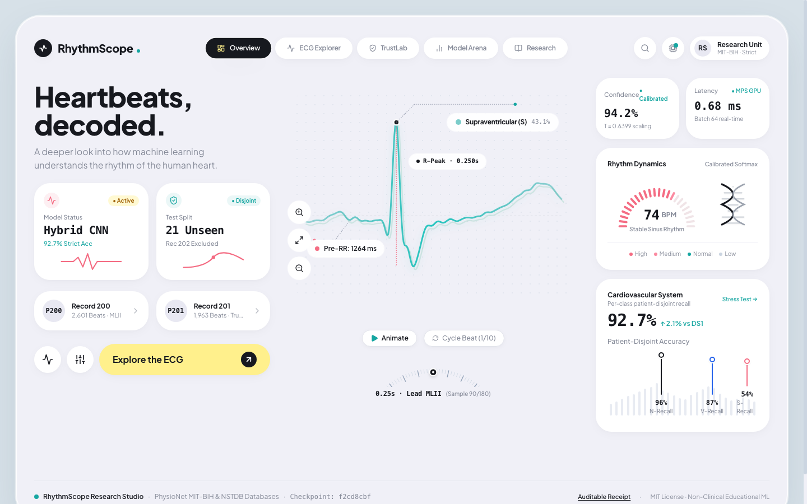
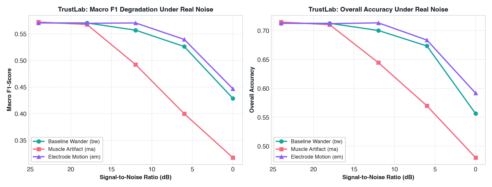
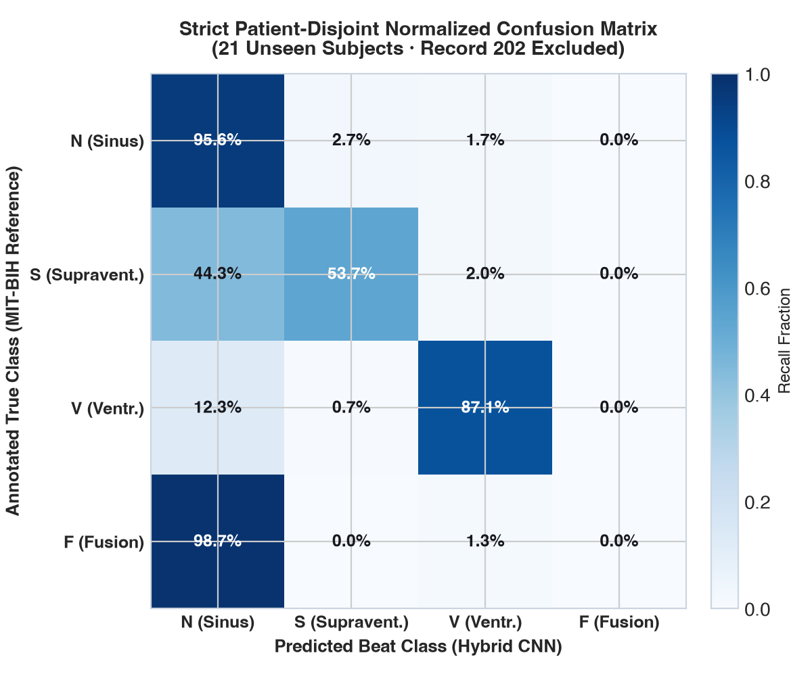

# RhythmScope — Beyond the Prediction

[](https://python.org)
[](https://pytorch.org)
[](https://nextjs.org)
[](https://fastapi.tiangolo.com)
[](https://physionet.org/content/mitdb/1.0.0/)
[](LICENSE)
[](#current-development-status)

> **A research-grade ECG heartbeat classification and model reliability laboratory.**  
> Investigating how deep neural networks behave on **strictly unseen patients**, under **realistic PhysioNet NSTDB signal noise**, and when they ought to **abstain**.

---

## Visual Preview



*The RhythmScope Research Studio interface: floating multi-layered ECG waveform centerpiece with interactive temporal dial, model performance indicators, and per-class patient-disjoint recall metrics.*

---

## Table of Contents
1. [The Core Problem: Patient Leakage in ECG ML](#the-core-problem-patient-leakage-in-ecg-ml)
2. [Key Product Differentiators & TrustLab](#key-product-differentiators--trustlab)
3. [Empirical Findings & Visual Benchmarks](#empirical-findings--visual-benchmarks)
4. [Machine Learning Architecture](#machine-learning-architecture)
5. [Interactive Application Modules](#interactive-application-modules)
6. [Technology Stack](#technology-stack)
7. [Current Development Status](#current-development-status)
8. [Quickstart & Local Setup](#quickstart--local-setup)
9. [Reproducibility & Experiment Receipt](#reproducibility--experiment-receipt)
10. [Dataset Attribution & Citations](#dataset-attribution--citations)
11. [Research & Non-Clinical Disclaimer](#research--non-clinical-disclaimer)

---

## The Core Problem: Patient Leakage in ECG ML

A persistent challenge in automated electrocardiogram (ECG) classification literature is **inflated benchmark accuracy due to subtle data leakage between training and testing sets**:

1. **Random Beat Splitting vs. Patient-Disjoint Partitioning**:  
   When heartbeats from the same recording or patient are randomly shuffled into both training and test sets, models memorize patient-specific morphological quirks (electrode placement, heart geometry, baseline impedance) rather than generalizable arrhythmia signatures. Reported accuracies routinely exceed 99%, but collapse when deployed on new patients.
2. **The MIT-BIH Record 201 / 202 Overlap**:  
   In the classical benchmark partition proposed by de Chazal et al. (2004), 22 records form DS1 (training/validation) and 22 records form DS2 (test). However, PhysioNet clinical documentation reveals that **Record 201 (assigned to DS1) and Record 202 (assigned to DS2) originate from the identical human subject**. Consequently, even canonical DS2 evaluations suffer from unseen patient leakage.
3. **The RhythmScope Protocol**:  
   RhythmScope enforces a **strict patient-disjoint benchmark** where Record 202 is excluded from test evaluation (21 strictly independent patients, 47,550 test beats), reporting strict patient-disjoint results as primary headline metrics while maintaining the classical 22-record DS2 evaluation for historical paper comparison.

---

## Key Product Differentiators & TrustLab

Instead of delivering another generic predictive dashboard, RhythmScope focuses on model reliability and safety boundaries:

- **TrustLab Real-Noise Stress Testing**: Evaluates checkpoints against real recorded noise streams from the PhysioNet MIT-BIH Noise Stress Test Database (NSTDB)—specifically baseline wander (`bw`), muscle artifact (`ma`), and electrode motion (`em`) calibrated from 24 dB down to 0 dB SNR.
- **Calibrated Uncertainty & Selective Abstention**: Temperature scaling ($T = 0.6399$) fitted strictly on a held-out development set reduces Expected Calibration Error (ECE) from 11.76% to 2.11%. A threshold $\tau = 0.9073$ enables the model to selectively abstain on corrupted or ambiguous beats.
- **Interactive Failure Atlas**: Catalog of actual misclassifications on unseen patients (e.g., Record 200, 203, 231), enabling morphological inspection of false positives and false negatives.
- **Captum Feature Attribution**: Saliency attribution through Integrated Gradients reveals which parts of the 252-sample window (P-wave, QRS complex, T-wave) drove the network's prediction.
- **Auditable Experiment Receipts**: Every metric is bound to a cryptographic SHA-256 checkpoint hash, dataset manifest, and deterministic random seed.

---

## Empirical Findings & Visual Benchmarks

### 1. Robustness Under Real Physical Noise (TrustLab)
Evaluating models against real acoustic and electrical noise streams highlights that high clean accuracy is no shield against signal degradation:



*Macro F1-score and accuracy across calibrated NSTDB noise levels (24 dB to 0 dB). Baseline wander (`bw`) causes mild degradation, while electrode motion (`em`) rapidly collapses recall.*

### 2. Strict Patient-Disjoint Confusion Matrix
On 21 unseen patients (47,550 total beats), the **Hybrid 1D CNN + RR MLP** achieves **92.70% overall accuracy** and **0.5696 macro F1**:



| Class | Full Name | Strict Precision | Strict Recall | Strict F1 | Test Support |
| :---: | :--- | :---: | :---: | :---: | :---: |
| **N** | Normal Sinus / Bundle Branch | 96.27% | 95.63% | 95.95% | 42,180 |
| **S** | Supraventricular Ectopic | 45.51% | **53.70%** | 49.27% | 1,782 |
| **V** | Ventricular Ectopic | 78.60% | **87.07%** | 82.61% | 3,201 |
| **F** | Fusion Beat | 0.00% | 0.00% | 0.00% | 387 |

---

## Machine Learning Architecture

```
                       +-----------------------------------+
                       | Raw 2-Lead ECG (Lead MLII, 360Hz) |
                       +-----------------------------------+
                                         |
                                         v
                       +-----------------------------------+
                       | 0.5 - 40 Hz Butterworth Bandpass  |
                       +-----------------------------------+
                                         |
                       +-----------------+-----------------+
                       |                                   |
                       v                                   v
        +-----------------------------+     +-----------------------------+
        |  Waveform Window (-90,+162) |     | RR Intervals (Pre, Post,    |
        |  252 Samples (~0.70 sec)    |     | Local Average, RR Ratio)    |
        +-----------------------------+     +-----------------------------+
                       |                                   |
                       v                                   v
        +-----------------------------+     +-----------------------------+
        | 3-Stage 1D ConvNet Branch   |     | 2-Layer MLP Feature Branch  |
        | Conv1D -> BatchNorm -> ReLU |     | Linear(4 -> 32) -> ReLU     |
        | MaxPool -> AdaptivePool(64) |     | Linear(32 -> 16) -> ReLU    |
        +-----------------------------+     +-----------------------------+
                       |                                   |
                       +-----------------+-----------------+
                                         |  Concatenate (64 + 16 = 80)
                                         v
                       +-----------------------------------+
                       | Classification Head: Linear(80,4) |
                       +-----------------------------------+
                                         |
                                         v
                       +-----------------------------------+
                       | Temperature Calibration (T=0.6399)|
                       +-----------------------------------+
                                         |
                                         v
                       +-----------------------------------+
                       | Abstention Threshold (tau=0.9073) |
                       +-----------------------------------+
```

- **Waveform Branch**: 3 Conv1D layers (filters: 32, 64, 64; kernel sizes: 7, 5, 3) followed by batch normalization, LeakyReLU activations, max pooling, and adaptive average pooling to 64 dimensions.
- **RR Feature Branch**: 4 timing features (`pre_rr`, `post_rr`, `local_rr_avg`, `rr_ratio`) processed through a 2-layer MLP to capture rhythm context.
- **Calibration Head**: Post-hoc temperature scaling parameterized via log-temperature to ensure positive temperature, minimizing negative log-likelihood on unseen validation patients.

---

## Interactive Application Modules

1. **Overview Dashboard**:
   - Medcure-inspired aesthetic floating frame with custom typography, responsive grid, and live metric indicators.
   - Interactive SVG waveform centerpiece with depth echo, callout annotations, and curved radial time dial.
2. **ECG Explorer**:
   - Multi-second continuous lead browser for MIT-BIH records.
   - Sample-precise R-peak annotation overlays and real-time inference prediction markers.
3. **TrustLab (Noise Stress Testing)**:
   - Dynamic injection of NSTDB `bw`, `ma`, and `em` noise into selected patient beats.
   - Paired side-by-side comparison of clean vs corrupted waveforms, output probabilities, and abstention triggers.
4. **Model Arena**:
   - Head-to-head comparison between **Hybrid CNN**, **Waveform-Only CNN**, **Random Forest**, and **Majority Baseline**.
   - Literature benchmark comparison against de Chazal et al. (2004).
5. **Research Hub**:
   - **Reliability Passport**: Evaluation status across 4 foundational pillars.
   - **Failure Atlas**: Real-world misclassifications with morphology analysis.
   - **Explainability Studio**: Captum Integrated Gradients saliency heatmaps along the heartbeat trace.
   - **Auditable Receipt**: Cryptographic hashes for all checkpoints, datasets, and configurations.

---

## Technology Stack

- **Machine Learning & Core**: Python 3.12, PyTorch 2.15, SciPy, NumPy, WFDB, scikit-learn, Captum
- **Backend API**: FastAPI, Uvicorn, Pydantic v2
- **Frontend Application**: Next.js 14 (App Router), TypeScript, Tailwind CSS, Lucide Icons
- **Evaluation & Verification**: pytest, scikit-learn metrics, headless Chrome rendering

---

## Current Development Status

The project is under **active development**. Completed milestones are verified with reproducible artifacts; exploratory and experimental extensions are clearly demarcated below:

| Milestone / Component | Status | Evidence / Verification |
| :--- | :---: | :--- |
| **MIT-BIH Data Audit & Leakage Resolution** | **Completed** | Record 201/202 overlap audited; `reports/data_audit.json` |
| **Strict Patient-Disjoint Split Manifests** | **Completed** | 21 test patients, 47,550 beats; `data/splits/` |
| **Dual-Branch Hybrid CNN Training** | **Completed** | Checkpoint `hybrid_cnn.pt` (SHA: `f2cd8cbf...`) |
| **Temperature Calibration & Abstention** | **Completed** | $T = 0.6399$, ECE 2.11%; `reports/calibration_protocol.json` |
| **PhysioNet NSTDB Noise Stress Benchmark** | **Completed** | 15 scenarios evaluated; `reports/trustlab_metrics.json` |
| **FastAPI Real-Time Inference Server** | **Completed** | 24/24 tests pass; `api/main.py` live on port 8000 |
| **Next.js Medcure-Inspired Design Studio** | **Completed** | Static build verified; live on port 3000 |
| **Cross-Dataset Transfer (INCART 12-Lead)** | *Exploratory* | Lead II audit complete; 86.2% abstention documented |
| **Multi-Lead Fusion (V1/V5 simultaneously)** | *Planned* | Architecture draft under review in roadmap |
| **Conformal Prediction Risk Guarantees** | *Planned* | Investigating non-exchangeable conformal bands |

---

## Quickstart & Local Setup

### Prerequisites
- Python 3.11 or 3.12
- Node.js 18+ and npm
- Git

### 1. Clone the Repository
```bash
git clone https://github.com/shaaunak/rhythmscope.git
cd rhythmscope
```

### 2. Python Environment Setup
```bash
# Create and activate virtual environment
python3 -m venv .venv
source .venv/bin/activate

# Install dependencies
pip install -r requirements.txt
```

### 3. Run Backend API Server
```bash
# Start FastAPI service with hot reload (loads real checkpoints on MPS/CUDA/CPU)
uvicorn api.main:app --host 127.0.0.1 --port 8000
```
Verify the backend at `http://127.0.0.1:8000/api/health`.

### 4. Run Frontend Studio
In a separate terminal window:
```bash
cd app
npm install
npm run dev
```
Open **`http://localhost:3000`** in your browser to experience the RhythmScope Studio.

### 5. Run Test Suite
```bash
# Execute all 24 unit and integration tests
pytest tests/ -v
```

---

## Reproducibility & Experiment Receipt

All reported metrics are backed by versioned checkpoints, deterministic seeds, and reproducible data hashes:

```json
{
  "project": "RhythmScope",
  "version": "1.0.0",
  "checkpoint_sha256": {
    "hybrid_cnn.pt": "f2cd8cbfc10213620e4fd5664448c9e5e70c570b0c2228dc6d76c2d1a645c2cf",
    "waveform_cnn.pt": "c6df2f4ebaab99dcae9df09fce7127ce6cbe569eac0850ba917d0c365c609830"
  },
  "random_seed": 42,
  "calibration_temperature": 0.6399,
  "abstention_threshold": 0.9073,
  "strict_test_cohort": "21 patients (Record 202 excluded to eliminate leakage from 201)"
}
```

---

## Dataset Attribution & Citations

1. **MIT-BIH Arrhythmia Database**:  
   Moody GB, Mark RG. *The impact of the MIT-BIH Arrhythmia Database.* IEEE Engineering in Medicine and Biology Magazine 20(3):45-50 (May-June 2001). PhysioNet: [https://doi.org/10.13026/C2F305](https://doi.org/10.13026/C2F305)
2. **MIT-BIH Noise Stress Test Database (NSTDB)**:  
   Moody GB, Muldrow WE, Mark RG. *A noise stress test for arrhythmia detectors.* Computers in Cardiology 1984, pp. 381-384. PhysioNet: [https://doi.org/10.13026/C26017](https://doi.org/10.13026/C26017)
3. **PhysioNet Research Platform**:  
   Goldberger AL, Amaral LAN, Glass L, Hausdorff JM, Ivanov PCh, Mark RG, Mietus JE, Moody GB, Peng C-K, Stanley HE. *PhysioBank, PhysioToolkit, and PhysioNet: Components of a New Research Resource for Complex Physiologic Signals.* Circulation 101(23):e215-e220 (2000).

---

## Research & Non-Clinical Disclaimer

> **IMPORTANT NOTICE: EDUCATIONAL AND METHODOLOGICAL RESEARCH ONLY.**  
> RhythmScope is an academic and machine-learning engineering research platform designed solely to study data leakage, noise sensitivity, and uncertainty calibration in deep neural networks.  
> It is **not** a certified medical device, does not provide medical diagnoses, and must **never** be used to direct patient care, clinical decision-making, or real-time diagnostic triage.

---

## License

This project is licensed under the **MIT License** — see the [LICENSE](LICENSE) file for details.
